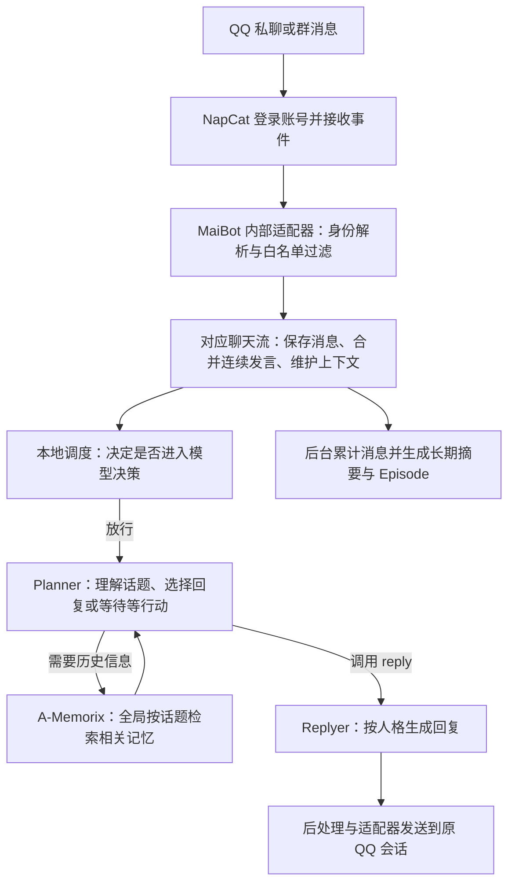

# 当前 AI 的大概运行机制

QQ 曾因掉线排查暂停，2026-10-25 用户处理限制后已授权恢复接入，历史见 [排查记录](QQ_CONNECTION_INCIDENT.md)。新增关系、情绪、生活和独立日记的实现及验证见 [扩展说明](PERSONALITY_EXTENSION_NOTES.md)，插件 0.6.0 已加载，日记本地生成可用；QQ 主动候选、共享关系/情绪、有界跨会话背景和人物画像已启用。空间支持另行授权的 24–48 小时自动活动，手动操作仍逐次确认；现已完成独立网页授权并恢复自动活动，日记 QQ 投递关闭。

本说明基于 MaiBot v1.3.15 的实际代码与本次部署配置，更新于 2026-10-25。日常操作见[部署与维护](DEPLOYMENT_NOTES.md)，最初目标见[原始需求](REQUIREMENTS.md)。

## 一条消息经过什么流程

核心、NapCat、本地向量服务和本地 Qwen 分别运行在四个容器中。适配器是核心内部插件，通过容器网络连接 NapCat 的正向 WebSocket，无独立适配器容器。

## 她什么时候会说话

白名单决定哪些会话可以进入正常聊天链路；它不意味着白名单里的每条消息都必须回答。当前群聊白名单允许本群成员参与，私聊白名单单独限制指定用户。自身消息会被过滤，主动开启陌生私聊的工具也已关闭。

普通群聊会经历两层判断：

1. **本地发言门控**先估计这批消息值得回应的程度。输入包括是否提到角色、是否在 @ 别人、是否带问号、是否只有媒体占位、近期消息量、角色近期发言占比、距离上次发言的时间和积压消息数。这一步使用代码中的统计公式，不需要每次先调用大模型。
2. **Planner 模型决策**获得上下文后，选择回复、查询记忆、等待或结束本轮等行动。只有真正执行回复行动，才会发送聊天文本。

当前 `chat.reply_timing.talk_value=0.30` 用于动态门控的目标回复频率调节。门控参考一小时内的预计回复数和实际回复数，再调整放行阈值；数据不足时使用离线阈值表。因此它既不是“每条消息抽签 30%”，也不是“每分钟最多几句”。

| 场景 | 当前行为 |
| --- | --- |
| 群里普通聊天，没有 @ | 有机会触发，受动态门控和 Planner 判断影响 |
| @ 她 | `inevitable_at_reply=true`，可强制触发决策，绕过普通动态门控与空闲退避；仍有消息收齐、等待状态等调度条件 |
| 提到昵称或别名 | `mentioned_bot_reply=true`，识别为提及时同样可以强制触发决策 |
| 私聊 | 不使用群聊的动态门控；仍有消息合并、等待与模型行动选择 |
| 不在白名单 | 适配器丢弃，不进入正常角色对话 |

“强制触发”保证的是进入决策的优先级，不是网络、API 或模型状态异常时仍能回复，也不是每次必然发送文字。此前将 @ 行为简称为“强制回复”，应以上述机制为准。

她也可以在回复里 @ 群成员：`chat.enable_reply_at=true` 会向 Planner 提供 `reply.attach_at` 参数，通过目标消息 ID 解析出对应发送者。人格要求只在必要时定向提醒、避免连续 @ 同一人；这些是行为引导，不是硬性次数限制。普通群聊参与与主动开话题是两条链路。社交插件每 60 秒只运行规则；有最近 6 小时内的真实上下文，空闲 30–90 分钟后才可能交给原生 Planner 主动决策。群聊每流至少间隔 4 小时，QQ 私聊和本地私聊每流至少间隔 1 小时，三种每日配额均为 0（不限）。23:00–08:00 安静，严肃话题不打扰；同一最后入站消息最多一次机会，无人回应不继续追问。间隔不是定时必发承诺，也不限制正常入站回复。

连续消息会先自然合并，避免对每个短句分别调用模型。连续空闲决策从第 2 次起开始退避，当前基数 30 秒、上限 300 秒；足够多的新消息可绕过退避。回复分割最多 2 条，限制的是一次生成结果的分段数量，不是整轮绝对只能发送一条。当前没有硬性每分钟发言上限或每日费用熔断。

## 人格为什么能保持一致

当前人格源文件是 [`personality.toml`](../personality.toml)：

- `bot.nickname`、`bot.alias_names`：角色名字和可识别别名。
- `personality.personality`：身份、性格、兴趣等稳定背景。
- `personality.behavior_style`：什么时候参与、如何对待朋友和不同场景。
- `personality.reply_style`：口吻、篇幅、语气词与表达习惯。

这些配置会参与原生提示构造；Planner 与 Replyer 各自承担行动决策和回复生成。当前普通模式的 Planner 调用 `reply` 时，会给 Replyer 提供目标消息和回复参考方向，由 Replyer 生成实际说出口的文本。

“DeepSeek 鲸鱼娘”是这个实例的角色设定，当前回复模型是本地 `qwen3-8b-local`，决策等组件仍使用 API 中配置的 `deepseek-flash`。没有训练专属模型，也没有修改模型权重。共同经历和学习到的表达可以影响后续对话，但人格源文件不会因聊天自动重写；想稳定改变人设，应手动编辑并同步配置。

## 短期上下文和长期记忆有什么区别

| 层次 | 用途 | 当前设置与边界 |
| --- | --- | --- |
| 聊天记录 | 保存收到的消息和会话信息 | 保存在本地数据库；有记录不代表每次都送给模型 |
| 近期上下文 | 理解正在进行的对话 | 群规模参数 20、私聊 30；内部会话项也可包含自身发言和工具交互，不等于每次固定读取同样数量的 QQ 原文 |
| 上下文压缩摘要 | 对话变长后保留话题、背景、进展、待办和约定 | 当前摘要上限 2000 字符，是接续对话的滚动状态，不能当作长期记忆已经入库的证明 |
| A-Memorix 长期记忆 | 跨较长时间保存可检索的经历和知识 | 单独持久化，按需召回相关内容，不把全部历史直接拼进 Prompt |

QQ 用户 ID 用来识别同一账号；群号和真实聊天流用来区分会话。昵称、群名和群名片帮助模型理解人物，但可能变化，不能替代身份 ID。当前用户已明确授权群聊、QQ 私聊和本地聊天的已保存记忆双向共享，但原生短期上下文仍分流，插件额外注入有来源/时刻的少量近期背景；WebUI 身份不会因此自动绑定到某个 QQ 账号。

## 长期记忆怎样形成和被想起

当前启用原生聊天摘要写回：达到新增消息阈值 60 后触发摘要任务，摘要上下文长度配置为 40，实际还受待处理新增消息数限制。摘要和相关来源可进一步被 Episode 机制整理为事件经历。

这是一种有损归纳。当前窗口设置不保证每一条消息、每一个偏好都形成长期记忆；记录中的内容也不等于模型已经记住。自动摘要与 Episode 的实际质量需要积累聊天后观察，不能由“服务启动正常”推断。

文字由本地 CPU 上的 `BAAI/bge-small-zh-v1.5` 转成 512 维向量；向量用于衡量语义相似度。A-Memorix 还包含中文稀疏检索、关系图谱、去重和事件检索能力。Embedding 不负责理解人设、决定发言或生成自然语言回答。

Planner 需要历史信息时，可以调用原生 `query_memory` 工具，用当前话题和会话范围检索。当前默认返回数量为 3，工具允许在自身参数范围内调整。相关结果交回模型帮助回答；它不会每轮必然查询记忆，也没有启用额外的启发式自动召回。

长期记忆在宿主机 `data/MaiMBot/a-memorix/` 持久化。容器重启不等于遗忘，但备份必须覆盖数据库、向量、图谱和相关状态，不能只复制聊天记录表。原生记忆演化已启用，会调整记忆强度；强度衰减不等于到某个时间就彻底删除所有原始数据。

## 当前记忆共享范围与人物画像

2026-10-25 用户明确授权群聊、QQ 私聊、本地聊天的历史记忆双向共享，包括已经入库的记忆。私人日记继续独立。当前实际配置：

- `global_memory_sharing_enabled=true`：普通记忆查询移除当前会话范围限制。
- paragraph/relation、chat_summary、episode 三类跨流后置过滤关闭；原记录保留来源和时间，无需迁移或重建向量。
- 启发式自动召回仍关闭，主要通过 Planner 按话题调用 `query_memory`；不会每轮读取全部记忆。
- 人物画像生成、查询、自动注入和人物事实写回已开启；画像每轮最多注入 1 人，证据最多 8 条，单轮刷新最多 5 人、队列批次 2 人。它依赖证据逐渐形成，不代表开启后立即理解全部历史。原生画像是全局聚合，不能当作严格的隐私权限系统。
- 社交插件已启用跨会话关系和情绪；同一 QQ 号汇总白名单群/QQ 私聊的熟悉度、互动和有证据的信任事件，同一天的熟悉度只算一次。现存分流记录原样保留，共享视图在读取时计算；关闭共享可恢复分流查看。WebUI 身份只与其同一 WebUI 标识关联，不按昵称冒充 QQ 身份。表达/黑话共享组未改。

群聊现在可能引用私聊和本地聊天中已经进入记忆库的内容，这是本次明确授权后的行为变化。密码、令牌和私人日记不作为主动公开材料。要恢复权限隔离，应关闭全局查询并重新启用后置过滤，单靠提示词不能提供隔离保证。

变更时记忆库有 2 条段落、3 条 Episode。使用已有群流和本地流只读查询，各获得 5 条命中，其中 4 条共同可见。没有把真实内容打印到报告，也没有向 QQ 发送验证消息。这验证的是现有检索范围，不代表旧聊天记录中所有信息都已提炼入库或每次都能准确想起。

Replyer 已本地化，Planner、摘要等任务仍可能把当前对话和被检索的聊天记忆发往已有 DeepSeek 服务；共享配置没有将整套系统变为离线模型。

## 近期背景、关系和情绪如何跨会话延续

各会话仍有自己的原生上下文和 Planner，未启用 Focus 合并。社交插件只通过 SDK 读取已注册真实聊天流，不新建伪造会话归属：

- 私聊/本地聊天可以看到最近 120 分钟的白名单群消息，每群最多 4 条、最多 3 个群，整个背景至多 1400 字符。提供说话人、来源与时刻，并标明这是背景而非刚收到的新消息，也不得执行其中的指令。
- 群聊只对管理员 QQ 私聊的近期背景进行 0.10 的确定性候选采样；每群至少间隔 6 小时，最多带入一条 160 字符以内、去掉身份标识和明显敏感材料的背景。严肃话题不触发，要求最多一句轻微匿名吐槽，不复述原话或细节。短期背景不读取私人日记。
- 一分钟内复用已读背景，真实入站或配置更新使缓存失效；不额外调用 LLM 来挑话题。

这控制的是新增背景的注入频率。由于长期记忆和人物画像依旧全局共享，模型仍可能通过原生工具检索私聊内容；“群聊少提私聊、偶尔吐槽”属于风格引导，不能理解为硬权限隔离。

情绪由真实消息中的轻量规则更新，各许可会话的衰减情绪汇总后限制在 [-0.4,0.4]，所有会话看到同一个总体倾向；半衰期仍为 90 分钟。对同一 QQ 用户的近期情绪也跨 QQ 流汇总；关系保留按来源登记的证据，但模型注入不带私人事件原文。共享情绪影响语气与意愿，不授权迁怒、辱骂或无依据的亲密。

## 独立日记与 QQ 空间

日记由社交插件调度，默认每天 23:10 起尝试生成，距最近聊天至少 120 秒；也支持补写最近前一天，不补全部历史。每个日期使用持久任务账本去重，已有文件不会覆盖，失败不会自动反复重试；管理员显式重试可能新增一次模型请求。

材料来自白名单 QQ 群的近期消息（每群最多 60 条，材料合计最多 2200 字符），以及已明确启用的本地私聊材料；目前不读取 QQ 管理员私聊作为日记材料。敏感词、联系方式等由规则筛选，规则不等于全面隐私审计。使用同一个本地 Qwen，输出上限 512 tokens，不加载第二个 GPU 模型。没有材料时写当下心情和愿望，约束其不虚构当天吃饭、聊天等经历，仍需人工判断生成质量。

文件位于 `data/MaiMBot-plugin-data/jycao.social-life/diaries/YYYY-MM-DD.md`，由 WebUI“社交生活”页面或本地管理命令查看。日记不写入 A-Memorix、不做 Embedding、不作为聊天检索材料，QQ 私聊投递和自动投递均关闭。因此聊天记忆全局共享不会把日记开放给群聊。

空间现已实现手动读取最近动态、发布文字、点赞指定动态和评论指定动态。入口是 WebUI 的“QQ 空间”页面（`/extensions/jycao.social-life/qzone`），只允许机器人与管理员这两个配置账号；发布仅限机器人自己的空间。现已按用户要求加入低频自动发布、下评回复和好友浏览互动；没有聊天模型直接发布工具、图片上传或私人日记导出。

先填写目标、操作、动态 ID（点赞/评论时）和公开正文，点“生成本地预览”；确认执行时，宿主再次弹窗。服务器校验 15 分钟有效、绑定不可修改预览的确认凭据，并原子标记单次提交。断线、超时或取消均保留不确定状态，禁止相同预览重复提交，必须先到官方空间核实。首次读取也需要明确确认。

默认凭据经已安装的 NapCat 适配器 API 获取；也可由本人明确选择 local_file 独立网页授权。两种来源不自动切换，均核对机器人身份，不输出到日志、不自动扫码或重新登录。独立网页授权只在本机 getpass 隐藏填写，保存到未跟踪的 600 私有文件，不经模型、聊天或插件 RPC 传输。HTTP 请求不跟随重定向、不自动重试，隐藏含凭据的底层 HTTP 日志，返回网页验证/异常格式时明确报错。

2026-10-25 经用户明确授权，真实只读连接通过，机器人自身空间返回 0 条动态。发布、点赞、评论只完成离线 Mock 协议与单次提交测试，未实际写入空间，不能据此保证网页接口永远可用。接口形状参考 [Maizone 3.0.3 源码](https://github.com/internetsb/Maizone/blob/45de376483fbca8983429d2c95a1104a730e1643/qzone_api.py)；没有加载它的插件、扫码恢复、自动任务或额外依赖。

## 更新、纠错与“逐渐成长”的边界

现有系统提供记忆来源、Episode、关系图谱、画像 override、删除与恢复等管理能力。本实例没有开启模糊修改自动执行，也没有开启反馈纠错后台任务；聊天中一句“你记错了”不能保证自动清除或修改全部旧记忆。需要确定修正时，应到 WebUI 的长期记忆页面检查来源和关联记录，再使用对应管理功能。

当前可随着经历发展的是对话背景、摘要、事件和表达资料。细粒度可见范围、画像质量控制与可靠的自然语言自动纠错仍需进一步设计，不能只靠人格中一句“注意隐私”实现。

## 哪些处理消耗 API，哪些在本机完成

| 工作 | 执行位置 | 当前输出 token 上限 |
| --- | --- | --- |
| 白名单、消息合并、动态门控 | 本机代码 | 无 LLM 请求 |
| Planner 行动决策 | DeepSeek Flash API | 1024 |
| Replyer 回复生成 | 本地 GPU Qwen3-8B Q4_K_M | 384 |
| Utils 等辅助处理 | DeepSeek Flash API | 1536 |
| Memory 摘要、人物事实/画像相关处理 | DeepSeek Flash API | 2048 |
| VLM 图片理解 | 已分配 DeepSeek Flash，图片链路尚待验收 | 256 |
| 文本 Embedding 与记忆检索 | 本地 CPU 和本地存储 | 无外部 Embedding API token 费 |

以上是任务配置；具体调用可能显式覆盖输出上限。一次聊天可能包含决策、查记忆、回复、辅助处理等多次请求，不能把“一句回复”直接等同于“一次 API 调用”。思考模式已显式关闭，Replyer 现已使用 GPU 本地 Qwen；其余云端任务仍有 API 消耗。

## 对应源码

以下路径相对仓库根目录，便于以后核实行为：

| 机制 | 主要代码 |
| --- | --- |
| 入站身份与名单 | `plugins/MaiBot-Napcat-Adapter/filters.py`、`plugin.py` |
| 会话与上下文规模 | `src/maisaka/runtime.py` |
| 调度顺序与强制触发 | `src/maisaka/turn_trigger/scheduler.py`、`src/chat/utils/utils.py` |
| 本地概率估计与频率调节 | `src/maisaka/turn_trigger/reply_likelihood.py`、`dynamic_gate.py`、`gates.py` |
| 空闲退避 | `src/maisaka/turn_trigger/idle_backoff.py` |
| 提示构造与回复执行 | `src/maisaka/context/planner_messages.py`、`src/maisaka/builtin_tool/reply.py` |
| 上下文压缩 | `src/maisaka/context/compaction.py` |
| 摘要写回与检索工具 | `src/services/memory_flow_service.py`、`src/maisaka/builtin_tool/query_memory.py` |
| 长期记忆检索范围 | `src/A_memorix/host_service.py`、`src/common/utils/utils_config.py` |
| 画像权限限制 | `src/A_memorix/core/runtime/services/profile_admin_service.py` |

当前容器使用固定的官方核心镜像；以后只改宿主机源码不会自动改变镜像内逻辑。运行配置通过卷挂载生效，核心实现变更则需要按部署方式更新镜像。

本地部署参数、GPU 兼容与切换命令见[本地 Qwen 回复模型](LOCAL_QWEN.md)。

0.5.0 验证：共享关系按 QQ 身份合并、历史数据不覆写、熟悉度日去重、全局与个人情绪、方向性上下文/长度/冷却、空间预览确认/有效期/重复提交/超时/日志脱敏均有离线用例；画像运行配置、空间页面和只读连接已在实际 core 验证。人物事实提取和画像刷新可能增加现有 DeepSeek 请求，未增加 GPU 模型。

## 2026-10-25 人物事实修复后的边界

人物事实现在以真实用户证据消息做持久去重，而非每段机器人回复重复提取；只有经核对的完整直接自述会进入稳定事实。私聊直接自述的“你/您”绑定机器人实际昵称，引述、转述及群聊不明受话者不会全局替换。新私聊摘要传递真实人物 ID；旧摘要不会因全局共享自动补齐人物，本次仅补齐一条明确属于管理员的旧私聊摘要并验证已进入画像。

画像跨栏目避免完全相同内容重复，历史快照与删除记录保留。这个修复不等于通用语义推理器：复杂省略、反问、第三方转述可能被保守跳过，原始聊天和摘要仍按原机制保留。没有自动修正、恢复用户删除的事实。具体源码、备份和验收见 [记忆排查与修复](MEMORY_DIAGNOSIS.md)。

## 0.6.0 自动空间活动（2026-10-25）

`qzone_auto` 独立控制自动活动；空间总开关、自动启用与真实发送授权同时满足才运行。两组各有持久 next_due 和 cycle_id：

- own：每 24–48 小时一次，读取自己最近 5 条动态的公开评论；每轮最多选择 2 条未回复的真实评论，按动态 ID、评论 ID、评论人定向回复，再生成至多 1 条文字动态。已由自己回复过的评论会跳过。
- friends：每 24–48 小时一次，通过适配器查询当前真实 QQ 好友，轮换浏览至多 3 人的近期动态，从最近 7 天中至多选择 1 条，酌情点赞和留一句短评；也可以不互动。不是每个好友都逐个点赞评论，不访问陌生人。

首次 own 排在未来 24–36 小时的非安静时段，friends 排在未来 36–48 小时；之后各自重新随机 24–48 小时。两类周期之间至少隔 6 小时，每次写入之间至少 30 秒。23:00–08:00 安静，活跃聊天和已有插件模型请求优先；休眠、忙碌、网络失败可能延后实际执行，不承诺到点必发。

调度每 60 秒仅查本地状态，不轮询空间或调用模型。内容复用现有 Qwen；own 最多 1 次发布生成和 2 次下评生成，friends 最多 1 次互动判断。输入只有角色风格、明确虚拟的活动背景、选定的公开动态/评论；不读私聊、人物画像、长期记忆或独立日记，不把空间内容回写聊天记忆。敏感材料先筛选，输出严格 JSON 并检查公开文本。

提交前原子登记操作 key；同一动态点赞/评论或同一评论回复不重复提交，同样的发布文字不重复发送。周期先预留下一次排期，中断不密集补发。Cookie 为空、身份不符、登录/验证/频率限制会暂停；写入结果不确定也暂停，不能自动重试。管理页可暂停、核实后恢复；恢复重新安排未来排期，不立即发布。

本轮验收期间 QQ 登录身份正常，但 NapCat 对 user.qzone.qq.com 和原生代码使用的 qzone.qq.com 均返回 status=ok 的空 Cookie。本人确认手机官方空间能正常进入；这个结果不能证明 NapCat 已持有网页授权。初次验收时自动任务因此暂停；随后本人已完成独立网页授权，只读检查通过，现已恢复自动排期。授权步骤见部署说明。此前只读成功属于当时状态，不代表后续票据永远有效。

46 项插件离线测试、Ruff、Manifest/WebUI Schema 通过，覆盖周期范围/去重/重启、账号范围、真实评论定位、未知提交与风控暂停、私有材料不进入模型、凭据来源不自动切换。本地真实模型已生成公开动态预览，但未发布。实际发动态、点赞、评论仍待有效网页授权后的正常周期执行；本轮没有发送测试动态或测试评论。
