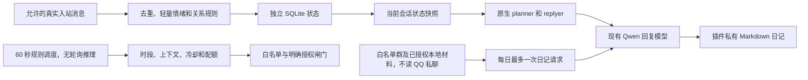

# 人格、社交生活与独立日记扩展

适用基线：MaiBot 1.3.15 / `062d45cf8`，SDK 2.16，Qwen3-8B Q4_K_M，RTX 4060 Laptop 8GB。2026-10-24 实施。

**当前状态：0.6.0 插件已挂载、启用并在实际 core 中加载，管理页与定时日记可用。** NapCat 曾因软件环境风险停止，2026-10-25 用户处理限制后已授权恢复，历史见 [QQ 掉线排查记录](QQ_CONNECTION_INCIDENT.md)。2026-10-25 经用户要求启用白名单群和管理员私聊低频主动候选；日记私聊投递、空间只提供逐次确认的手动操作，未发送 QQ 测试消息。原人格源、模型配置、长期记忆隔离规则保留；核心只调整回复拆分上限为 2，数据未重置。

## 已有能力与本次边界

MaiBot 已具备人格、上下文压缩、MaiSaka 决策、提及优先、回复拆分、群发言频率、表情动作和 A-Memorix 的按会话检索。群中不 @ 也可能依据 talk_value 和 planner 决策回复；talk_value 已从 0.2 小幅调至 0.3。允许回复 @ 的原设置保留。新的低频定时主动候选是另一项能力，现在允许在白名单内触发原生主动决策。

本机适配器为独立插件 NapCat Adapter 1.4.1。没有安装 Affection、MaiTrace、Maizone、生活模拟第三方插件。轻量社交状态与独立日记需要额外实现，本次放在 `plugins/social_life_plugin/` 独立 Git 仓库中，不改主程序或 A-Memorix，实现层全部使用官方 SDK。

原生 A-Memorix 继续负责聊天的长期经历；当前已按用户明确授权开启聊天记忆全局共享，人物画像现已开启，私人日记保持独立。本插件不重复检索记忆，不写 Embedding，不自动建立跨会话公开画像。原始关系按真实 session_id + QQ 用户 ID 保留来源，当前读取时按同一 QQ 身份汇总；熟悉度按全局活跃日去重。当前原生长期记忆双向共享；近期背景使用方向性限制，详见最新机制文档。

## 架构



日记没有接回聊天和记忆的路径。图中的 Qwen 只是同一服务实例的不同请求；planner 等原有任务是否使用 DeepSeek 仍由现有 model_config 决定，并非本次已将整个系统全部本地化。

### 回复与决策

- 接入 `chat.receive.after_process`、`send_service.after_send` 统计真实流的轻量元数据。首次消息若真实流尚未注册则跳过，不自造归属 hash。
- 使用 `maisaka.planner.before_request` 的标准 Context Item 和 `maisaka.replyer.before_request` 的 extra_prompt，保留人格源及原有消息/工具配对。三语模板在 `prompts.py` 同步维护。
- 群聊通常一两句，有内容可补充；私聊通常两到四句，跟随对方节奏；严肃求助允许详细解释。状态只作倾向，不硬裁剪每条回复。回复较早的消息时，通过限定 chat_id 的本地消息查询选择被回复者的关系，不误用最新说话者；目标无法定位时不注入任何人的关系。重试时替换自己的提示区块，避免重复追加。
- 最近 75 秒已回复 3 次，或 10 分钟出现相同文本指纹时，频率调整乘 0.5；多人活跃或低精力时再取较低值，不覆盖原生 @ 优先机制。卸载/关闭频率功能后，仅恢复仍由自己持有的调整，避免覆盖其他插件。
- 没有对每条消息做额外 LLM 分析，没有增加表情、图片或第二个 GPU 模型。文本指纹只能发现完全重复，语义近似仍依赖原生上下文与决策。
- 核心 max_split_num 已设为 2，允许原生分割器偶尔拆成两条；不会强制每次拆分。部署模板版本为 5。NapCat 停止期间没有实际增加 QQ 发送条数。

### 关系、情绪和虚拟生活

`social_snapshot(session_id)` 提供同一份当前会话状态；其他插件可通过 SDK 公共 API 获取不含正文、日记和事件原文的状态，无需重复分析。其余管理 API 默认非 public，经已有 WebUI 鉴权和白名单绑定提供本地管理入口，不作为模型工具。QQ 只注册管理员日记读取命令；当前投递授权关闭。插件 API 的 public 是插件间可见性，不是互联网匿名 HTTP 接口。

熟悉度按活跃日缓慢增加，每天最多 0.2；互动计数独立维护，普通聊天不改变长期信任。重要事件需通过受保护的 `relationship_event` 接口提供同一真实聊天流、用户、近期消息 ID、原因及幂等事件 ID。单次信任变化最多 0.03；更正可追加反向有证据事件。没有自动推断高好感度，也未实现跨用户复杂社交图谱。

短期愉快度按当前聊天流和各个用户分别记录，通过少量正负词规则变动，每次最多 0.06、总体限制 ±0.4，90 分钟半衰期。精力来自虚拟时段，社交意愿由精力和短期情绪计算；好奇心为轻量倾向。它们是简化规则，不声称可靠理解讽刺或复杂情绪；暂时情绪不改原人格和长期信任。

生活活动在阅读、发呆、游戏、休息、听歌等有限集合中按日期与时段变化；虚拟生活标志始终开启，不当成真实身体或人类线下经历。规则不占用 GPU。

### 主动候选

部署模板默认禁止真实 QQ 主动发送。当前用户已明确授权，运行配置已开启白名单群、管理员私聊主动候选；日记投递保持关闭。

有近期真实话题、空闲 30–90 分钟后才有机会；严肃话题不主动打扰；超过 6 小时的上下文不触发。每群冷却 240 分钟、每个 QQ 私聊和本地私聊冷却 60 分钟；总、群、私聊每日配额均为 0（不限），23:00–08:00 安静。同一最后入站消息最多一次候选，没人回应不会继续追问。dry_run 也占配额，避免启用瞬间补发积压。

通过授权闸门后调用现有 `maisaka.proactive.trigger`，由原生决策判断能否自然开口；机会配额不等于保证发送次数。它可能使用现有 planner 的 DeepSeek，不能把这部分称为零 API 成本。

### 独立日记

- 23:10 起，每分钟只做条件检查；距最近入站至少 120 秒再生成，每日期自动领取一次。每日时间之前可补最近一天缺失日记，不批量补历史；catchup_previous_day 可关闭。也可通过受保护的 `diary_generate(day)` 请求最近七天之一。
- 只从当前白名单群按目标日期查询最多 60 条，过滤机器人、命令、明显敏感关键词、URL、联系方式和长账号数字，输入最多 2200 字。不读取 QQ 管理员私聊、人物画像、记忆检索结果或旧日记。本机另已显式允许默认 WebUI 本地私聊作为私有日记材料；这不会将本地私聊加入 QQ 群的记忆。过滤是规则筛选，不能保证识别所有被群友转述的隐私。
- 同一 Qwen3-8B 非思考服务，每次最多 512 输出 Token。插件内日记串行；llama.cpp 原有 parallel=1，忙碌时仍可能与聊天竞争这一推理槽，不能保证完全不增加排队时间。
- 单独持久任务账本先领取，成功后原子落盘且禁止覆盖人工修改。失败或进程中断不自动重试；启动时将未完成任务标为 interrupted。通过 diary_retry 或 CLI retry 明确授权额外模型调用后，保留旧任务再重试；存在文件时仍禁止覆盖。正常自动调度按日期去重，显式重试是例外，不保证每日必定成功。
- 文件为 `data/MaiMBot-plugin-data/jycao.social-life/diaries/YYYY-MM-DD.md`，目录 700、文件 600；独立数据库为相邻 `social.sqlite3`。生产目录和 2026-10-24 日记已创建。目录和文件归宿主持久卷用户（本机 1000:1000），保持 700/600，支持本人查看、编辑和删除。
- 管理员私聊命令支持 `看看今天的日记`、`/diary`、`/diary YYYY-MM-DD`。投递授权关闭时不发送；群聊和非管理员不返回正文。尚未用真实 QQ 验收。
- 未来授权投递使用适配器直接私聊 API，绕过 core 的普通发送/记忆通知链；必须同时保持 NapCat 自身消息上报关闭和适配器 ignore_self_message=true。旧客户端已经停止，新客户端迁移后需重新验证这两个条件，不能直接启用日记投递。
- 针对无材料时编造经历的问题，人设现作为写作参考，事实约束位于系统提示；无材料采用只写当下感受、愿望和明确假想的独立任务。保存前拒绝明显的过去经历、敏感数字/密钥和思考文本；违规会记为失败，不套固定正文掩盖。最终无材料样本 122 字，通过同一验证器。规则无法穷尽语义性幻觉，事实准确性和口癖仍需人工抽查。

## 文件、配置与维护

| 路径 | 内容 |
| --- | --- |
| `plugins/social_life_plugin/` | 独立插件源码、配置模型、测试；本地 config.toml 未跟踪 |
| `deploy/qq/social/config.template.toml` | 完整默认模板，未填写账号且插件关闭 |
| `deploy/qq/compose.yaml` | 已包含持久的插件源码挂载；只重建 core，未启动 NapCat |
| `deploy/qq/social/manage.py` | 本地状态、日记查看/生成/显式重试、关系查看与事件更正 |
| `plugins/social_life_plugin/webui.json` | 使用原生预置组件的本地管理页，无额外前端构建 |
| `deploy/qq/social/check_runtime.py` | 已加载插件、匿名拒绝、日记去重和数据库完整性检查，不调用模型或 QQ |
| `deploy/qq/social/check_local.py` | 只用合成材料请求现有 Qwen，无 QQ/记忆写入 |
| `data/deployment-config-backups/social-20261024-231648/` | 本次配置和人格保真备份，包含敏感配置，勿公开 |

人格源 `deploy/qq/personality.toml` 未改动；备份 SHA256 校验一致。本次没有修改主程序、A-Memorix、依赖锁文件或实际 model 配置；实际 bot 配置仅变更 response_splitter.max_split_num。恢复开发前新增保真备份 data/deployment-config-backups/social-v2-20261024-233700/，与上一次备份都保留。

主要配置位于插件 `config.toml`：behavior 调整群/私聊长度偏好、连续回复和重复窗口；emotion/relationship/life 分别关闭各模块；proactive 调整机会开关、私聊开关、冷却、配额和安静时段；diary 调整生成时间、相对目录、材料与 Token 上限、自动投递和授权。`social.qzone_enabled` 只接受 false：空间功能尚未实现，不让开关伪装成可用能力。

WebUI 登录 `http://localhost:18001` 后进入插件扩展“社交生活”，可查看任务和按日期查阅/生成日记。沿用已有令牌鉴权，没有新开管理端口。常用本地命令：

```bash
.venv/bin/python deploy/qq/social/manage.py status
.venv/bin/python deploy/qq/social/manage.py diary --day 2026-10-24
.venv/bin/python deploy/qq/social/manage.py generate
.venv/bin/python deploy/qq/social/manage.py retry --day 2026-10-24 --confirm-model-call
.venv/bin/python deploy/qq/social/manage.py relation --session 实际聊天流ID --user QQ号
.venv/bin/python deploy/qq/social/manage.py event --session 实际聊天流ID --user QQ号 --event-id 唯一事件ID --evidence-id 同流消息ID --reason 更正原因 --delta -0.03
.venv/bin/python deploy/qq/social/check_runtime.py
env -u PYTHONPATH PYTEST_DISABLE_PLUGIN_AUTOLOAD=1 .venv/bin/pytest -q plugins/social_life_plugin/tests
.venv/bin/ruff check plugins/social_life_plugin
```

本地日记读取会向终端显示正文，勿将输出粘贴到公开报告。停用扩展不删除状态；迁移时保留插件独立仓库、本地配置和整个 `data/MaiMBot-plugin-data/jycao.social-life/`。SQLite 热备份使用 backup API 或先正常停插件再复制，避免遗漏 WAL。

## 验证及性能

27 项自动化用例通过（最近几轮约 4–5 秒）：身份与会话隔离、不保存入站正文、关系惯性/证据/更正、情绪衰减、去重、重复输出、安静时段/冷却/日配额/不追问、任务竞争与重启去重、日记路径/权限/不覆盖、隐私材料筛选、原工具配对保留、错误配置拒绝、连续消息零额外 LLM、频率恢复、日记模拟全链路、管理员投递授权及失败不自动重试。新增验证覆盖各用户独立情绪、回复对象匹配、三语完整提示、重试提示去重、中断恢复与显式重试、空白日记事实约束、跨日期串行模型调用和最近一天补写。Manifest 通过当前主程序 Schema 和兼容校验；Ruff 通过。测试使用合成账号和 Mock API，不证明真实 QQ 平台投递成功。

现有 core 容器内的合成推理结果：

| 场景 | 输出字数 | 输入/输出 Token | 耗时 |
| --- | ---: | ---: | ---: |
| 原人格玩笑 | 68 | 910 / 46 | 14.583 秒 |
| 增加行为提示的玩笑 | 40 | 1049 / 26 | 1.536 秒 |
| 严肃私聊 | 90 | 1025 / 60 | 2.441 秒 |
| 无公开材料日记 | 187 | 1049 / 119 | 4.825 秒 |

上表保留初期诊断样本，不作为最终内容质量结论；无材料旧样本中发现了编造描述，已针对性修正。实际已加载插件自动生成的本地日记：4.708 秒、1567 输入 / 119 输出 Token，任务 done；重载后再次生成请求返回 file_exists，调用数仍为 1。最终空白日记样本：3.644 秒、1111 输入 / 82 输出 Token、122 字，通过保存前同一验证器。诊断阶段也曾出现 27–89 秒慢请求（当时 GPU 显存约 7.6GB），之后恢复；不能保证负载下延迟不增加。各次样本受缓存、预热、其他请求和输出长度影响，不能得出插件会降低回复延迟的结论。提示示例增加约 139 输入 Token；实际状态内容有变化。100 次状态写入+快照读取平均约 11.52ms/对，是临时目录内的离线规则测量，不是线上端到端延迟。

未新加载 GPU 模型；验证请求直接复用现有 Qwen，不访问 DeepSeek。普通消息新增 LLM 调用为 0；日记按目标日期自动生成一次，补写与显式重试的调用单独可见；主动功能关闭时额外推理为 0。插件 metrics 记录日记次数、错误、累计延迟和宿主返回的 Token；social_status 分别给出插件等待量和正在执行量。完整聊天请求/Token 仍看 MaiBot 原统计；没有实现整台推理服务器的历史队列仪表盘。

## 第三方插件静态审查

| 候选 | 已核对的 Manifest/README | 当前决定 |
| --- | --- | --- |
| [Affection System](https://github.com/feiyunming/maibot-affection-system) 1.2.0 | Host/SDK 范围涵盖本机，tomlkit 依赖，逐消息自动 LLM 评价 | 不安装，避免重复关系状态与高频分析 |
| [MaiTrace](https://github.com/Rabbit-Jia-Er/MaiTrace) 6.2.4 | Host>=1.3.11、SDK>=2.15，较多日期/网页依赖，含日记与空间扩展 | 不安装；需进一步审查消息回流和空间授权 |
| [Maizone](https://github.com/internetsb/Maizone) 3.0.3 | 声明依赖 snowluma-adapter，本机旧 NapCat 插件不满足该依赖 | 不绕过依赖，不自动启用空间 |
| [LifeSimulationPlugin](https://github.com/SkonJIYHD/LifeSimulationPlugin) 2.0 | 声明 Host>=1、SDK>=2，依赖 aiosqlite | 功能重叠，不叠加第二套状态与调度 |

这些仅是静态版本范围与功能审查，未运行第三方代码，不是兼容性背书。QQ 空间发布、点赞、评论，图片/语音生成都没有启用。扩展已在离线 QQ 状态下加载；账号连接已恢复，现按用户授权启用低频主动候选，日记投递继续关闭。真实群聊 @ 优先、拆分节奏和私聊日记送达尚未实测，不能用离线结果代替验收。

本地交互已启用，见 [本地聊天](LOCAL_CHAT.md)。0.3.0 新增 webui 默认私聊的关系/情绪观察、本地独立主动授权和本地私人材料日记开关；QQ 主动候选现已按用户授权启用，日记投递仍关闭。

## 0.4.0：分类冷却与不限日配额

`proactive.group_cooldown_minutes=240`，`private_cooldown_minutes=60`（也用于本地私聊）；分类值未设置时兼容旧通用间隔。`daily_limit`、`group_daily_limit`、`private_daily_limit` 均设为 0 表示不限；安静时段、空闲窗口、上下文过期、白名单和不追问仍生效。新增测试覆盖分类间隔边界，以及取消日配额后仍去重。原生记忆的全局共享与私人日记独立边界详见 [机制文档](AI_MECHANISM.md)，不合并社交状态表。

## 0.5.0：共享状态、有界近期背景、人物画像与手动空间

当前实现和边界统一见 [AI 机制文档](AI_MECHANISM.md)。新增 `cross_context.py`、`qzone.py`、`qzone.html`；配置新增共享关系/情绪、跨会话背景及空间白名单。仅使用 SDK 和已存在的 httpx，依赖声明同步到 pyproject.toml/requirements.txt，无新 GPU 模型。关系原始数据不覆写，新增 context_shares/qzone_actions 仅保存去重和手动确认状态。

空间管理页通过宿主自定义页面沙箱调用受保护 API，不能直接读取管理令牌。发布/点赞/评论均先准备绑定内容的本地预览，再逐次确认；没有聊天工具自动执行或定时任务。只读实测账号一致、返回 0 条动态；写操作未实测，失败不自动重试。日记路径、生成和隔离不变。

0.5.0 最终验收：33 项离线测试通过，Ruff 与原生 Manifest/WebUI Schema 校验通过；实际 core 共享状态和画像开关已确认，空间逐次确认拦截通过，真实只读返回 0 条动态；没有执行真实空间写入或 QQ 群测试消息。

## 0.6.0 低频自动空间

新增 qzone_schedule.py / qzone_automation.py，自动功能按当前用户明确授权配置；own 和 friends 独立 24–48 小时，持久去重、重启不补发、未知提交/验证要求暂停；没有新增 GPU 模型。自动好友范围来自当前真实好友列表，手动白名单仍独立校验。Cookie 来源明确选择，独立网页授权仅本机隐藏输入；不通过聊天/模型传递。46 项离线测试与原生 Schema 校验通过，真实本地 Qwen 生成预览通过；当前因 NapCat 空凭据而暂停，没有真实写入测试。操作和当前边界见最新 [机制文档](AI_MECHANISM.md) 与部署说明。

### 独立网页授权已完成并恢复（2026-10-25）

本人在本机隐藏输入有效网页授权后，credential_source=local_file，凭据文件权限 600，只读空间请求通过。已解除空间自动暂停，首次 own 周期为北京时间 2026-10-26 09:56:58，friends 周期为 2026-10-26 19:33:58；后续分别随机 24–48 小时，安静/忙碌或休眠可能延后。没有立即补发，自动操作历史仍为空。

适配器和 NapCat 原始 get_friend_list(no_cache=true) 均返回成功且为空列表，不是适配器把已有列表解析丢失。当前好友互动无可用目标，每轮会重新读取真实好友列表；没有擅自添加好友。没有为了验收发布动态、点赞或评论。独立授权到期时会暂停并要求本人更新，不自动重新登录。
